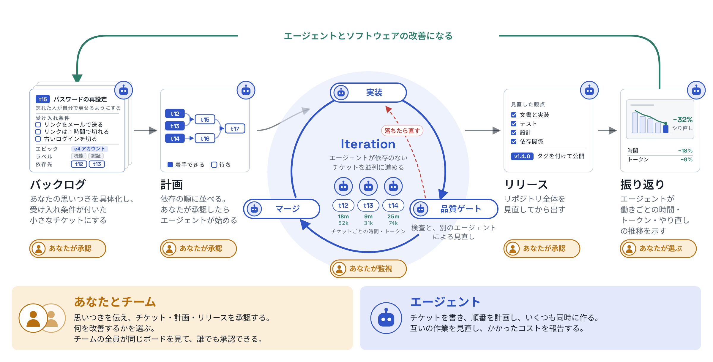
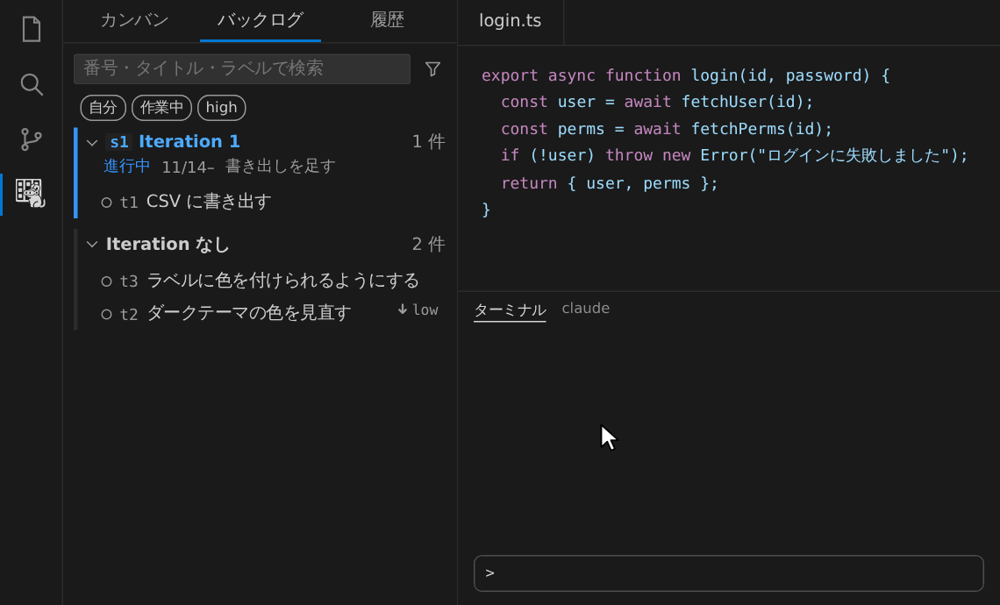
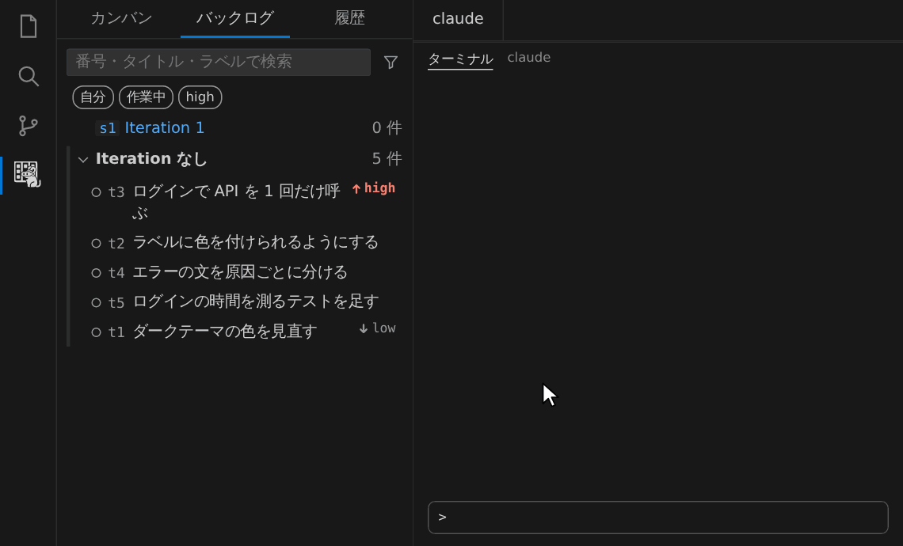
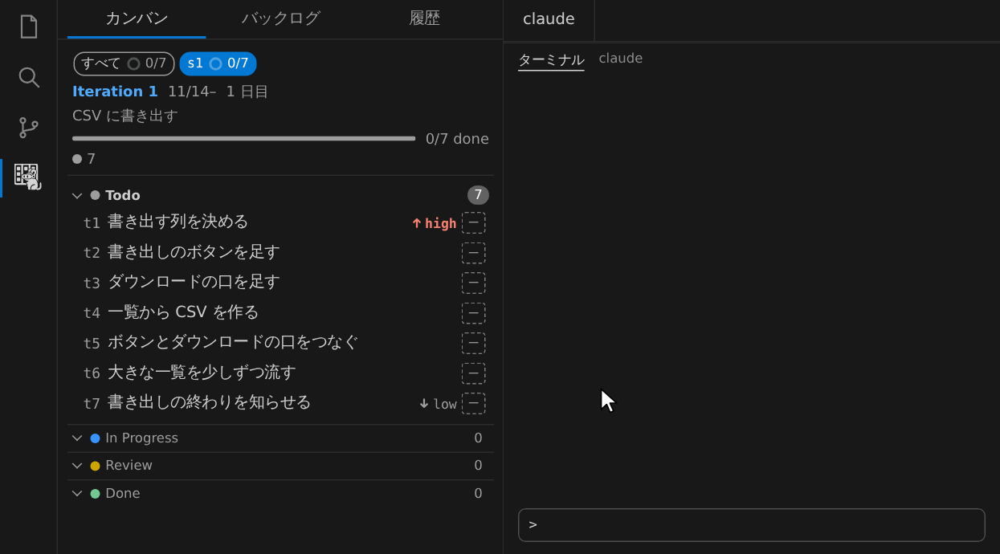
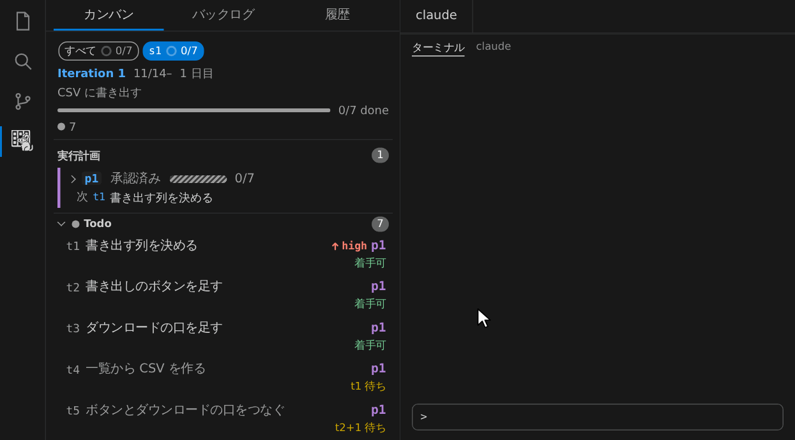
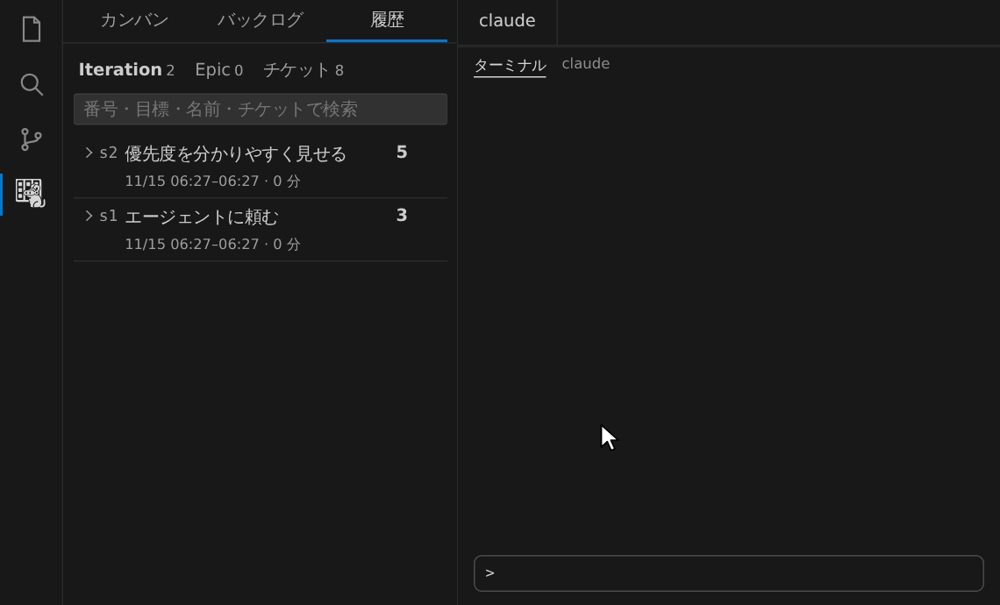
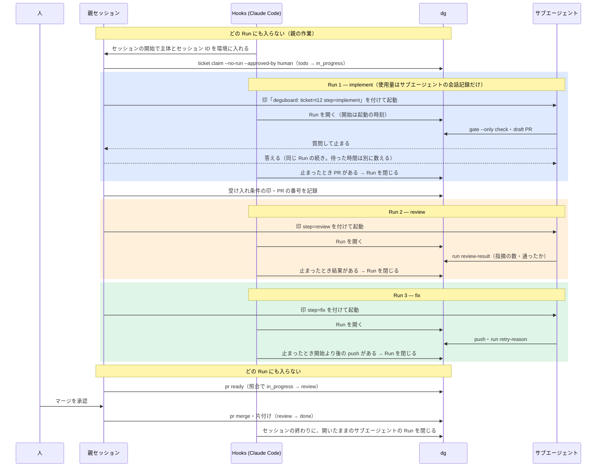

ブレインパッドで機械学習エンジニアをしている、7年目の北島です。

最近は Claude Code に、メールの文面から設計、実装、技術調査、資料の下書き、日々の相談まで、なんでも頼むようになりました。AI、便利ですよね。

すべて任せたいと思いながら、プロジェクトでいつも眺めている Jira のチケットを見ていたとき、ふと「チケットやカンバンも AI に任せたいな」と思いました。AI がいい感じにチケットへ落とし込んで勝手に実装し、テストと見直しと振り返りまで全部やってくれて、自分は眺めて確認するだけ。そんな機能がほしいなと。

同じようなことを考えている人はいないかと探したら、いました。Microsoft の Daniel Epstein さんが Microsoft Developer Blog で紹介した Agentic-Agile です。まさにこれをしっかり言語化していて、読んで「これだ」と思いました。

まだ提唱されたばかりの考え方のようだったので、せっかくなら実践してみようと、支援ツールを作ってみました。この記事はその紹介です。

## Agentic-Agile とは

Agentic-Agile は本家のアジャイルと同じようにマニフェストを掲げています。マニフェストの本体はリンク先を読んでもらうとして、ここでは5つの価値だけを紹介します（訳は筆者によるものです）。

- ブログ：[Agentic-Agile: Why Agent Development Needs Agile (Not Just Prompts)](https://developer.microsoft.com/blog/agentic-agile-why-agent-development-needs-agile-not-just-prompts/)
- マニフェスト：[Toward an Agentic-Agile Manifesto](https://github.com/microsoft/agentic-agile-template/blob/main/MANIFESTO.md)

1. 曖昧なプロンプトよりも仕様と契約（Specifications and contracts over open-ended prompts）
2. 一方向の委任よりも人間とエージェントのパートナーシップ（Human-agent partnership over one-directional delegation）
3. 順番の引き継ぎよりも並行して独立に進められること（Parallel independence over sequential handoffs）
4. 後付けのコンプライアンスよりも組み込まれたガバナンス（Built-in governance over bolted-on compliance）
5. 事後の評価よりも継続的な計測（Continuous measurement over post-hoc assessment）

AI と開発するときのコツは、すでにいろいろ言われています。たとえば「Docs as Code が大事」「受け入れ条件を定義しよう」「大きな単位で丸投げしない」「設計だけは人間がやろう」などです。AI に守らせたい決まりを CLAUDE.md や Skill に書いた、という工夫もあります。このマニフェストは、それらをほぼ網羅しています。さらに、振り返りによる継続的な計測や、開発の流れに組み込んだガバナンスのように、これまであまり言及されてこなかったことも大事だと言語化してくれています。

*筆者が解釈した、Agentic-Agile を実践する開発の流れ*

:::message
この図は Agentic-Agile そのものを表したものではありません。私が Agentic-Agile を実践するうえで解釈した開発の流れです。
:::

## deguboard

Agentic-Agile を実践するには、Claude Code の Skill やプラグインだけではカバーしきれず、何かしらの仕組みが要りそうです。そこで作ってみたのが deguboard です。普段は VS Code で開発しているので、VS Code の拡張機能にしました。

*deguboard のアーキテクチャ*

:::message
本家の Agentic-Agile にのっとっていない箇所や、言葉の定義の違う部分があります。あくまで私が Agentic-Agile を実践してみるための支援ツールです。
:::

見た目はこんな感じで、VS Code の左パネルにカンバンボードやバックログが出ます。

<図>：左パネルのカンバンとバックログのスクリーンショット。

### 相談してチケットにする

Claude に「こういう機能がほしいな」と相談して中身が決まったら、Claude がそれを小さなチケットに分けて起票してくれます。そのあとチケットをスプリント（deguboard では Iteration と呼んでいます）に入れて計画を頼みます。すると、変更するファイルや機能の依存関係から、いちばん並列で進めやすい実行順のツリーを作ってくれます。

*相談からチケットを起票する*

*チケットをスプリントに入れる*

*実行順のツリーを作って承認する*

### 並列で実装する

チケットの中身と実行順を確認したら、いざ実装です。こんな感じで、実行順のツリーに沿って複数のエージェントが並列にチケットを片付けていきます。ツリーがだんだん埋まっていくのを見るのが楽しいです。

*実行順のツリーに沿って並列に実装する*

### 品質ゲートを通るまで直す

チケットの実装が終わると、設定した品質ゲート（テストや lint などのチェックと、別のエージェントによる見直し）を通るかを確かめてくれます。通らなければ勝手に修正の作業に戻って、品質ゲートを越えるまで頑張ってくれます。

<図>：品質ゲートで止まり、修正して通るまでの GIF。

### スプリント全体を見直す

スプリントのチケットがすべて終わったら、次はスプリント単位の見直しです。チケット単位では見過ごしていた問題を探します。見直しの観点は、ドキュメントと実装の食い違い、テスト、アーキテクチャ、README、依存関係、設定ファイルの6つです。この見直しで結構問題が見つかるので、それもチケットに起票して AI に片付けてもらいます。

<図>：スプリント全体の見直しと、指摘の起票の GIF。

### 振り返る

ようやく終わりが近づきました。最後に振り返りをします。まだ模索中ですが、Agentic-Agile が掲げる継続的な計測を意識した観点で振り返っています。deguboard ではエージェントが作業したときの時間とトークンを記録しているので、従来のアジャイルにはない指標で振り返れるのが楽しいです。

今 deguboard に用意している振り返りの観点は次のとおりです。観点ごとに、エージェントが指標を提案し、承認したものだけを使います。

- 成果：スプリントの目標を達成したか。終わったもの、やめたもの、持ち越したものは何か
- 見直しの効き目：見直しがマージの前に不具合を見つけ、少ない往復で収まったか
- 仕様の質：チケットの受け入れ条件と範囲が、手戻りなく通る成果物を引き出せたか
- 分け方：ぶつからずに並行して進められる大きさと境目に分けられたか
- エージェントの安定：エージェントの作業が失敗や中断、やり直しなく終わったか
- コスト：時間とトークンをどこに使い、成果に見合っていたか
- 改善の追跡：前回の振り返りの Try を終え、狙った数字が動いたか

次の画像は、見栄えのために振り返りの結果を HTML にしたもののスクリーンショットです。

<図>：振り返りを HTML にしたもののスクリーンショット。

以前のスプリントと比べてメトリクスが良くなっているか、エージェントが何度も失敗している原因はないか、といった、次のスプリントをもっと効率よく進めるためのヒントを探します。結果を Keep、Problem、Try に整理してくれるので、必要なものをバックログに起票します。

*振り返りの指標を承認し、改善を起票する*

とまあ、こんな感じのツールです。実際の開発に使い始めていますが、AI に任せつつも品質を保ちながら、気持ちよく開発できています。

あくまで個人用のツールですが、v1.0.0 を [VS Code の Marketplace](https://marketplace.visualstudio.com/items?itemName=deguboard.deguboard-vscode) に公開しているので、よければ使ってみてください。インストールとアンインストールの手順や、ドキュメントも一応用意しています。ソースコードは [GitHub](https://github.com/brainpad-whiterabbit/deguboard) にあり、MIT ライセンスです。

## 苦労したところ

意外と難しかったのが、エージェントの作業ごとにメトリクスを取る仕組みです。プロンプトで「ここからここまでの会話のトークン量を測って」のように指示しても、それっぽいメトリクスは取れます。ただ、セッションが途切れたり、実装の量が多くなってエージェントが指示を忘れたりして、歯抜けになったり不正確になったりしてしまいます。

決定的に動く仕組みが必要だということで、Claude Code のフックの機能を使い、なるべく正確に取れるようにしています。全体的に、プロンプト頼りにならない仕組みを考えています。

次の図は、エージェントの1回の作業の記録（Run）がどこからどこまでかを示したものです。色の付いた区間がそれぞれ1つの Run です。

そもそも Agentic-Agile の支援ツールにはどんな機能が要り、どんな仕組みで実現すればよいかを考えるところからのスタートでした。マニフェストを見ながら、どの機能が大事で何を削るか、使い勝手を考えた画面のデザイン、カンバンのデータをどう管理するか、フックの仕様の調査などを進めました。VS Code の拡張機能として作るかどうかも、最初は決まっていませんでした。

## 最後に

個人的に気に入ったので、これからも使い続けるつもりです。Agentic-Agile は良い開発手法だと感じているので、deguboard とは関係なくおすすめです。

deguboard の内部の仕組みに興味があれば、[こちら](https://github.com/brainpad-whiterabbit/deguboard/blob/main/docs/how-it-works.ja.md)に少し載せているので見てみてください。
